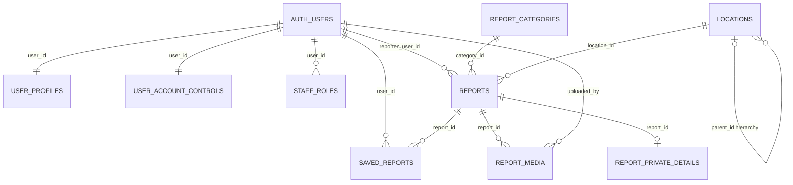
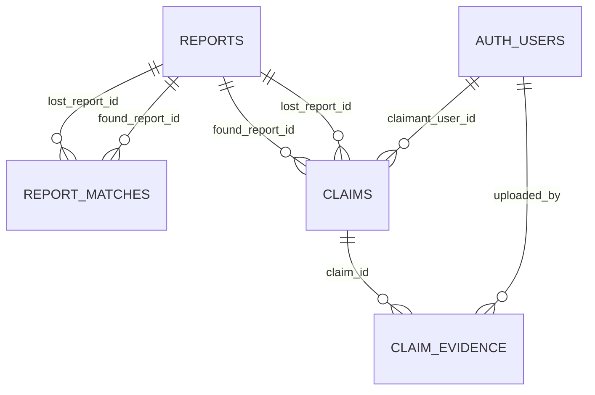
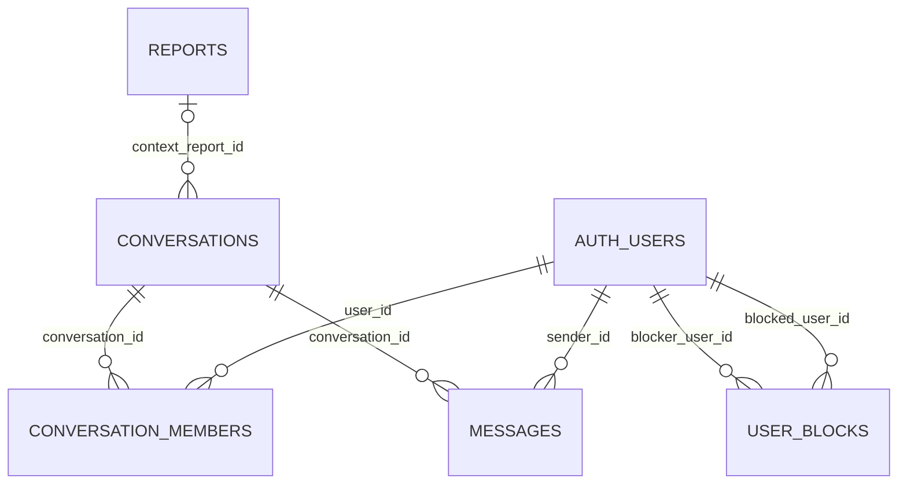
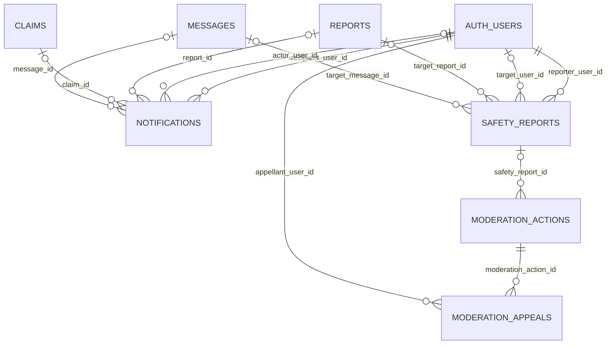
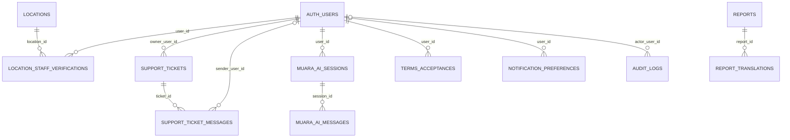

# MuaraKu — Database Map & Review Notes

> **Status:** Dokumen ini memetakan sumber skema legacy dan bukan kontrak untuk
> database live. Installer lokal `MuaraKu_Fresh_Install_v2.2.sql` menyertakan
> penyederhanaan di bagian akhir dengan pemeriksaan 22 tabel. Database Supabase
> live belum dapat dibandingkan dalam sesi ini; verifikasi read-only wajib
> dilakukan sebelum menerapkan asumsi atau proposal apa pun.

**Source:** `database/source/muaraku_supabase_schema(2).sql` (file uploaded by the user). This document maps the explicit foreign keys, primary/unique relationships, and the intent stated in SQL comments. It does not replace runtime testing.

## 1. Important source rules

- Auth identity is `auth.users`; public profile and app data live under `public.*`.
- Names and columns below follow the user's SQL exactly.
- `public.report_translations` is present in the source schema but is **out of current product scope**. Do not implement post translation merely because this table exists.
- Relationship lines in Mermaid show declared foreign keys. Many-to-many associations and semantic rules also depend on composite primary keys, checks, triggers, functions and RLS—not just FKs.

## 2. Relationship overview

### User identity, roles, reports and taxonomy

`AUTH_USERS` in the diagram represents Supabase's `auth.users`; it is not a user-created public table. `SAVED_REPORTS` has a composite primary key `(user_id, report_id)`, so the same user/report pair can only be saved once.

### Matching and claims

Semantic constraints from the SQL:
- `report_matches` must connect one report with `report_type='lost'` to one with `report_type='found'`; a trigger checks it.
- `claims` must connect a found report and a lost report. A trigger requires the claimant to own the linked lost report and not be the owner of the found report.
- `report_matches.overall_score` is bounded from 0 to 1 and explicitly is only a suggestion, not proof of ownership.
- `claim_evidence` is intended to be private and must only be available to authorized claim participants/staff according to RLS and Storage policies.

### Conversations, members, messages and blocking

- `conversation_members` has composite primary key `(conversation_id, user_id)`.
- `user_blocks` has composite primary key `(blocker_user_id, blocked_user_id)` and prevents self-blocking.
- One seeded Global Chat conversation has fixed UUID `00000000-0000-4000-8000-000000000001`; its messages are not seeded by this schema. UI must not invent messages.
- Direct conversation creation is intended to go through RPC `public.muaraku_create_direct_conversation(...)`, which checks active users, blocks, report context and membership.

### Notifications, safety and moderation

`safety_reports` uses `target_type` plus a check constraint to require exactly one target among user, item report or message. `moderation_actions` records staff actions. `moderation_appeals` has a unique constraint on `(moderation_action_id, appellant_user_id)`.

### Locations, support, AI and policy records

`notification_preferences.user_id` is a primary key and FK to `auth.users`; therefore it is at most one preferences row per user (the diagram represents this relationship approximately). `user_profiles.user_id`, `user_account_controls.user_id`, and `notification_preferences.user_id` are intended as one-row-per-user tables.

## 3. Table inventory and declared relationships

| Table | Purpose based on SQL | Key relationship(s) |
|---|---|---|
| `user_profiles` | Public-facing profile fields and user preferences | `user_id → auth.users.id` (PK/FK); `avatar_path` points to Storage object path |
| `user_account_controls` | Account status/restriction metadata | `user_id → auth.users.id` (PK/FK); `updated_by → auth.users.id` |
| `staff_roles` | Staff role assignments | `user_id`, `granted_by → auth.users.id`; unique `(user_id, role)` |
| `report_categories` | Report categories with ID/EN names | Referenced by `reports.category_id` |
| `locations` | Location hierarchy and coordinates | `parent_id → locations.id`; `created_by → auth.users.id` |
| `reports` | Lost/found item reports | Owner → auth; optional category/location FKs; parent for private details/media/matches/claims/saved reports/translations |
| `report_private_details` | Owner-only verification clues/contact preference | `report_id → reports.id` (PK/FK, 1:0..1) |
| `report_media` | Report media metadata and Storage object path | `report_id → reports.id`; `uploaded_by → auth.users.id` |
| `report_matches` | Lost/found candidate pairs and scores | Both `lost_report_id` and `found_report_id → reports.id`; unique pair |
| `claims` | Claim/ownership-verification workflow | Found and lost report FKs; `claimant_user_id`, `reviewed_by → auth.users.id` |
| `claim_evidence` | Private evidence attached to claim | `claim_id → claims.id`; `uploaded_by → auth.users.id` |
| `saved_reports` | User bookmarks | Composite PK `(user_id, report_id)`; FKs to auth and reports |
| `conversations` | Global, direct, or report-context conversation | Optional `context_report_id → reports.id`; `created_by → auth.users.id` |
| `conversation_members` | Conversation-user association | Composite PK `(conversation_id, user_id)`; FKs to conversations/auth |
| `messages` | Chat messages/attachments | `conversation_id → conversations.id`; `sender_id → auth.users.id` |
| `user_blocks` | Directional user block records | Composite PK `(blocker_user_id, blocked_user_id)`; both to auth |
| `notifications` | User notifications linked to relevant entities | `recipient_user_id`, optional actor/user, report, claim, message FKs |
| `notification_preferences` | In-app/email preference flags | `user_id → auth.users.id` (PK/FK) |
| `safety_reports` | User-reported safety issues | Reporter/assignee and optional target user/report/message FKs; target-type check requires exactly one target |
| `moderation_actions` | Staff moderation action history | Actor and optional target user/report/message/safety report FKs |
| `moderation_appeals` | Appeals against eligible moderation actions | `moderation_action_id`, appellant, reviewer FKs; unique action/appellant pair |
| `location_staff_verifications` | Requests and outcomes for verified location staff | `user_id → auth.users.id`, `location_id → locations.id`, `verified_by → auth.users.id`; unique user/location pair |
| `support_tickets` | Support requests | Optional `owner_user_id`, `assigned_to → auth.users.id` |
| `support_ticket_messages` | User/staff replies and internal notes | `ticket_id → support_tickets.id`; optional sender FK |
| `report_translations` | Cached translated report title/description in source SQL | `report_id → reports.id`; unique `(report_id, source_content_version, target_language)`; **not active product scope** |
| `muara_ai_sessions` | User AI conversation/session metadata | `user_id → auth.users.id` |
| `muara_ai_messages` | User/assistant messages and token metadata | `session_id → muara_ai_sessions.id` |
| `terms_acceptances` | Versioned acceptance records | `user_id → auth.users.id`; unique `(user_id, document_type, document_version)` |
| `audit_logs` | Audit events/metadata | Optional `actor_user_id → auth.users.id` |

## 4. Delete behavior in declared foreign keys

The schema explicitly uses `ON DELETE` behaviors; application flow must account for them:

- `CASCADE`: profile/control/roles, report children such as private details/media/matches, saved reports, conversation members/messages, claim evidence, AI session messages, terms acceptance, and similar children are deleted with their parent as declared.
- `SET NULL`: some attribution/target links are retained as rows while their user/report/message/claim/location references become null; examples include `reports.reporter_user_id`, `notifications` references, moderation targets and audit actor.
- `RESTRICT`: claims and evidence, uploaded media attribution, and some moderation links prevent deletion while dependent records remain.

For the exact behavior, consult every `REFERENCES ... ON DELETE ...` clause in the source SQL rather than relying on this summary.

## 5. Non-FK links to Supabase Storage

The SQL creates private buckets and uses path conventions; these are **object-path contracts**, not PostgreSQL foreign keys:

- `report_media.object_path` → object in `report-images`, intended path `<user_id>/<report_id>/<filename>`.
- `claim_evidence.storage_path` → object in `claim-evidence`, intended path `<claimant_user_id>/<claim_id>/<filename>`.
- `messages.attachment_path` → object in `message-attachments`, intended path `<sender_user_id>/<conversation_id>/<filename>`.
- `user_profiles.avatar_path` → object in `avatars`, intended path `<user_id>/<filename>`.

Bucket read/insert/delete policies are in the source SQL and should be tested in Supabase using real authenticated contexts.

## 6. Related functions and triggers to know

- `muaraku_handle_new_auth_user()` inserts a profile, account-control row and notification preferences row after a new `auth.users` row.
- `muaraku_set_updated_at()` backs multiple `updated_at` triggers.
- `muaraku_bump_report_content_version()` increments `reports.content_version` when report content columns change and resets moderation status to `pending_review`.
- `muaraku_validate_claim_relationship()` enforces lost/found pairing and claimant relationship.
- `muaraku_validate_match_relationship()` enforces matching only lost/found report types and approved reports for inserts/relationship changes.
- `muaraku_create_direct_conversation(...)` is the controlled RPC to create/reuse direct conversations.
- `muaraku_withdraw_claim(...)` allows a claimant to withdraw an eligible claim.
- RLS helper functions include role, active-user, report-owner, blocking, conversation-member/visibility/send and claim-visibility checks.

## 7. What this document does not assume

- It does not assume SQL has been applied to the target Supabase project.
- It does not assume any table can be inserted/updated from the browser; grants and RLS must both allow the operation.
- It does not invent an embedding/vector table for semantic AI search; the source includes a full-text index on reports and `report_matches`, but no report embedding/vector column/table in the inspected schema.
- It does not add a token wallet/balance table; source logs token counts per AI message but does not define a stored user token balance.
- It does not remove `report_translations` from the source. Product scope says not to implement translation of posts.

## Review items — verify before relying on behavior
### 1. Notifications: update grant without update RLS policy visible in source

The SQL grants authenticated users `UPDATE(read_at)` on `public.notifications`, but the shown notification policies include a read-own `SELECT` policy and no `UPDATE` policy for `recipient_user_id = auth.uid()`. Under RLS, the grant alone does not authorize the row update. If the UI must mark notifications as read, test this operation in the current Supabase project and propose a scoped policy or server route if needed. Do not patch the source file silently.

### 2. Post translation table conflicts with current feature scope

The source includes `public.report_translations`, a `translations_read_visible_report` policy, grants, and a service-role grant. Product decision says no translate feature on posts. Do not add translation UI/API/jobs/cache usage. Do not drop the table in this task; propose a migration only if the user explicitly wants to remove it.

### 3. AI Search: no vector/embedding schema declared

The schema has `reports_search_idx` using PostgreSQL full-text search on title, description, brand and color; it also has `report_matches` for lost/found candidate scores. No embedding column/table or vector index is declared in this file. If semantic/vector search is planned, document the approach and propose the DB requirements before coding it. Do not assume pgvector is installed.

### 4. Token balance vs usage tracking

`muara_ai_messages` records provider/model and input/output token counts, but the source does not declare a user token wallet/balance or quotas table. Any admin “balance” display must be defined as a computed usage report or a separately approved quota design, not described as an existing balance field.

### 5. Global Chat daily clearing

The source seeds one Global Chat conversation and defines messages with `created_at`/`deleted_at`, but the schema itself does not schedule a daily cleanup job. If policy remains “clear at 00:00 WIB”, determine the retention semantics and implement a trusted scheduled job outside this SQL, with audit/backup considerations. No client-side-only deletion.

### 6. Claims and moderation transitions

The source has checks/triggers/RLS/grants that protect claims and report status. Verify each transition (submitted, under review, more info, approved, rejected, withdrawn, completed), including which role can trigger it. Do not let the client directly set review outcomes merely because a UI button exists.

### 7. Private media and clues

`report_private_details` contains private verification clues/contact fields; `claim_evidence` is private evidence; all Storage buckets are defined private. Keep these out of public report cards, ordinary search results, and AI prompts unless explicitly authorized and necessary. Test signed URLs and Storage object policies under owner/participant/staff accounts.

### 8. Public visibility and deletion lifecycle

Some foreign keys use `ON DELETE SET NULL`, including `reports.reporter_user_id`; other dependents use `CASCADE` or `RESTRICT`. Decide account-deletion/data-retention behavior before enabling account deletion. Do not assume deleting an auth user deletes every related record identically.

### Review workflow

For each item, record: reproducible test, expected policy, observed result, severity, proposed fix, migration/policy diff, rollback plan, and explicit user approval. Test in development first.
