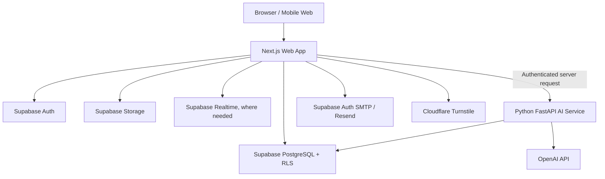

# MuaraKu — Product Requirements Document (PRD)

> **Status:** Draft v1.1 — implementation contract for AI coding agents  
> **Last updated:** 2026-10-11  
> **Product:** MuaraKu (`muaraku.id`)  
> **Primary stack:** Next.js + TypeScript, Supabase (PostgreSQL/Auth/Storage/Realtime), separate Python FastAPI AI service, OpenAI API  
> **Companion documents:** `DESIGN.md`, `muaraku_supabase_schema.sql`, `CHANGELOG.md`, `README.md`

---

## 0. Instructions for AI Coding Agents

This document is the implementation contract for the project. Read it fully before changing code.

### Required first actions

1. Inspect the existing repository and report its current framework versions, package manager, route structure, auth implementation, database access patterns, UI components, tests, environment variables, and unfinished/prototype areas.
2. Read `DESIGN.md` completely. It is the source of truth for visual design, page structure, navigation, component behavior, and responsive states.
3. Read `muaraku_supabase_schema.sql` completely. Build a table/relationship map before implementing database-backed features. Do not assume the SQL has already been applied to the Supabase project or that its policies are correct merely because they exist in the file.
4. Read the existing `README.md`, `.gitignore`, package manifest, current migrations, and any `AGENTS.md` or other repository-specific instructions.
5. Create or update `CHANGELOG.md` and a persistent task checklist before implementation.
6. Run the existing app and available checks before making changes. Record baseline failures so they are not misreported as regressions.
7. Produce a short audit report with: current state, reusable code, broken/prototype areas, security risks, schema mismatches, missing environment variables, and proposed phased plan.
8. Implement incrementally. After each meaningful phase, run relevant tests and update the changelog/checklist.

### Non-negotiable agent rules

- **Do not rebuild from scratch by default.** The repository exists and contains prototypes. Preserve working behavior and reuse components where reasonable.
- Do not delete, rename, replace, or redesign existing features without a demonstrated need and explicit explanation.
- Never execute destructive database operations against a connected or production database. Never drop tables, truncate data, reset a remote database, or overwrite migrations as a shortcut.
- Treat `muaraku_supabase_schema.sql` as the intended schema reference, not proof of the live schema. Compare it with actual migrations/schema only through an explicitly authorized, non-destructive inspection.
- Do not invent columns, relationships, provider settings, or business rules. If implementation reveals a mismatch, document it and propose a safe migration.
- Never claim a feature, test, migration, deployment, security review, or performance target is complete unless it was actually executed and its result recorded.
- Never put credentials, OTPs, access tokens, private ownership clues, or sensitive message contents in logs.
- Do not expose Supabase secret/service-role keys, OpenAI keys, Resend keys, Turnstile secret keys, or OAuth client secrets to the browser.
- All AI output is untrusted input. Validate structured output and enforce authorization in application code; never allow a model to grant ownership, ban users, or execute privileged actions autonomously.
- Use comments for important non-obvious decisions, security boundaries, complex algorithms, database invariants, and workarounds—not to narrate every line.
- Avoid large unrelated refactors. Keep changes reviewable and use small commits if Git is available.
- If a requirement cannot be completed safely with available credentials or infrastructure, implement a clear interface/stub only when useful, mark it incomplete, and document the exact blocker. Never fake a successful integration.
- Keep secrets out of `PRD.md`, `CHANGELOG.md`, screenshots, logs, and Git history.

---

## 1. Product Overview

### 1.1 Summary

**MuaraKu** is a trusted digital lost-and-found community for Indonesia. It helps people report lost items, report found items, discover relevant reports, communicate safely, and verify ownership through a structured process. AI assists discovery and communication but never replaces human judgment or proof of ownership.

**Brand idea:** “Muara” is a safe meeting point where separate paths converge. The product should make returning lost property calmer, clearer, and less risky.

### 1.2 Problem

People who lose or find an item often do not know where to post, where to search, or how to contact the other party safely. Public social posts can be scattered, difficult to search, and vulnerable to scams. A finder may be reluctant to reveal all details publicly; an owner needs a way to prove ownership without exposing private clues.

### 1.3 Product principles

1. **Trust before virality:** protect users and private details over engagement metrics.
2. **AI assists; people decide:** AI matching is a lead, not proof. Moderation suggestions are not automatic punishment.
3. **Privacy by default:** publish only the information needed to identify a report; keep ownership clues private.
4. **Clear state transitions:** reports, claims, moderation actions, and account restrictions must have explicit states.
5. **Accessible and calm UI:** use the visual rules in `DESIGN.md`, with clear feedback for loading, empty, error, success, and disabled states.
6. **Incremental delivery:** establish a reliable core before advanced AI or high-cost features.
7. **Measurable performance:** measure before optimizing and avoid unnecessary network calls, queries, and model calls.

### 1.4 Goals

- Let users securely register, verify email, log in, and manage sessions.
- Provide Seeker and Finder reporting flows, Discover feeds, search, report detail, claims, and safe communication.
- Protect user data through server-side authorization and tested Supabase Row Level Security (RLS).
- Provide an operational moderation workflow with traceable decisions and appeals where applicable.
- Add a separate Python/FastAPI service for exactly two initial AI features using OpenAI API: Natural Language Search and Muara AI CS.
- Give administrators a privacy-conscious view of AI usage, token consumption, estimated costs, and MuaraKu-configured budget remaining.
- Keep the existing UI aligned with `DESIGN.md` and responsive on mobile and desktop.
- Make future AI coding sessions resumable through `CHANGELOG.md`, checklists, tests, and architecture notes.
- Ship public pages with technical SEO and good performance without indexing private application data.

### 1.5 Non-goals for the initial release

- Guaranteeing that an item match is correct or that a claimant is the owner based only on AI.
- Automatic account bans based only on an AI score.
- Publicly exposing private evidence, contact details, exact sensitive locations, or internal moderation notes.
- Training a custom foundation model from scratch.
- Building a complex microservice mesh. The AI service is the only intentionally separate application service at this stage.
- Introducing payments, subscriptions, or advertising unless a separate approved requirement is added.
- Replacing Supabase Auth with a custom password or OTP implementation.

---

## 2. Users and Roles

### 2.1 User roles

- **Visitor:** can access public marketing pages and public report information explicitly intended for public viewing.
- **Authenticated user:** can create and manage their own reports, save reports, submit claims, communicate within allowed conversations, manage their profile and preferences, and report/block accounts.
- **Seeker:** a user workflow for reporting/searching for an item they lost. This is a product activity, not necessarily a separate authorization role.
- **Finder:** a user workflow for reporting an item they found. This is a product activity, not necessarily a separate authorization role.
- **Verified location staff:** a staff identity linked to a location only after an authorized verification process. A verification badge must not be self-assigned.
- **Moderator:** can review safety reports and content within explicitly granted permissions, take documented moderation actions, and handle appeals according to policy.
- **Administrator:** can manage authorized administrative functions and role assignments. Privileged actions require server-side authorization and audit logging.
- **Support operator:** can answer support tickets with access limited to the data required for support.

Do not infer role from client-side metadata or user-submitted profile fields. Use a trusted authorization source and server-side checks. Prefer permission checks over broad “admin” booleans.

### 2.2 Core user stories and acceptance criteria

**Authentication**
- Given an unverified email, when a user signs up, then the configured Supabase Auth flow sends an email verification code and does not grant the intended verified state until the code is valid.
- Given an invalid, expired, or reused OTP, when it is submitted, then verification fails safely with a clear user-facing message and no session privilege escalation.
- Given Google OAuth is configured, when a user chooses Google login, then Supabase handles the OAuth flow and returns to an allowlisted application URL.
- Given CAPTCHA protection is enabled, when an auth request is made, then the client supplies a valid Turnstile token and Supabase validates it.
- Given an authenticated user logs out, when logout succeeds, then protected routes no longer treat the user as authenticated.

**Reports**
- Given a signed-in user, when they submit a valid lost/found report, then the server validates all fields, associates the report with the authenticated user, and stores it using the intended schema.
- Given a user edits or deletes a report, when the request is processed, then it succeeds only if the user owns the report or has an explicitly authorized moderation permission.
- Given a report contains private ownership clues, when the public report is displayed, then those clues are not included in public API responses, page source, metadata, or logs.

**Search and feeds**
- Given filters and a query, when a user searches, then results are paginated, filters are validated, and only reports visible to that user are returned.
- Given a report is removed, restricted, or otherwise not public, when a public feed is requested, then it is excluded according to the report visibility rules.

**Claims and messaging**
- Given a user wants to claim a found item, when they submit evidence, then evidence is private to authorized participants and reviewers.
- Given a claim is accepted or rejected by an authorized decision-maker, when its status changes, then the transition is validated and recorded.
- Given a user blocks another user, when either tries to initiate a prohibited interaction, then the server rejects the action and the UI communicates the restriction.
- Given a user is not a conversation member, when they open a copied/guessed conversation URL or request messages, attachments, or Realtime data, then the server/RLS denies access without leaking content or membership metadata.
- Given the daily Global Chat reset runs, when it completes, then prior-day global messages disappear according to retention rules while direct/report conversation histories remain intact.

**Moderation**
- Given a user reports unsafe content, when the report is submitted, then it enters a review queue with a traceable case ID.
- Given an AI system flags content, when it produces a risk score, then the result is a review signal only unless an explicit, approved policy defines a narrow automated action.
- Given a moderator acts on a case, when the action is saved, then the actor, target, reason, timestamp, and relevant audit metadata are recorded.

**AI**
- Given a user searches in natural language, when AI search interpretation is available, then the system converts the query into a validated search intent and executes a constrained database query; it must not run arbitrary SQL.
- Given AI suggests a lost/found match, when the suggestion is shown, then the user sees it as a potential match with an understandable explanation, not a verified ownership claim.
- Given OpenAI is unavailable or rate-limited, when an AI feature is requested, then the product returns a graceful fallback and core non-AI features remain usable.

---

## 3. Product Scope and Priorities

### P0 — Core MVP and trust foundation

1. Existing project audit and environment setup.
2. Public Home, About, Support, Privacy Policy, and Terms of Service pages.
3. Supabase Auth integration: signup, email OTP/verification, login, logout, reset password, session handling, optional Google OAuth when configured, CAPTCHA when configured.
4. Profile basics and account settings.
5. Create, view, edit, close, and manage Seeker/Finder reports.
6. Discover feed; separate Seeker and Finder views; dedicated Search page and filters.
7. Report detail with privacy-aware public and private data separation.
8. Claim submission and ownership-verification flow.
9. Private messages/conversations with access checks, block handling, and basic notifications.
10. Safety report and block flows.
11. Basic admin/moderation queue with server-side role checks and audit logs.
12. RLS verification, schema compatibility checks, input validation, error states, basic automated tests.
13. SEO for public pages and exclusion of private app pages from indexing.
14. `CHANGELOG.md`, `README.md`, environment template, setup instructions, and task checklist.

### P1 — AI assistance and stronger operations

1. Separate Python FastAPI service with typed request/response schemas and health endpoint.
2. Muara AI CS based on approved help content.
3. Natural Language Search with constrained intent parsing.
4. Global Chat daily reset, non-AI spam controls, and human moderation workflow.
5. Admin AI-usage dashboard, estimated cost/budget remaining, and usage alerts.
6. Verified location staff workflow.
7. Notification preferences and more complete notification handling.
8. Rate limits, observability, usage/cost tracking, and AI provider fallback.
9. Integration and end-to-end test coverage for key user journeys.

### P2 — Later improvements

1. Image similarity matching if there is a justified model/provider, budget, and privacy plan.
2. Advanced analytics and moderation insights.
3. More robust queue/background processing if traffic justifies it.
4. Additional languages, accessibility refinements, and performance optimization based on measurements.
5. Advanced AI tools only after the baseline features are stable and evaluated.

### Explicitly deferred

- Automatic ownership decisions based on model output.
- Automatic permanent bans based only on an AI score.
- Unbounded agent/tool execution against the database.
- Expensive AI calls on every feed render or keystroke.
- Custom model training before evaluating prompt-based approaches, embeddings, and provider costs.

---

## 4. Technical Architecture

### 4.1 Approved baseline

- **Web application:** existing Next.js application using TypeScript. Preserve the current App Router or Pages Router choice unless audit shows a compelling reason to migrate.
- **UI:** existing component system and styling; follow `DESIGN.md`. Do not introduce a second design system without need.
- **Database:** Supabase PostgreSQL.
- **Authentication:** Supabase Auth.
- **File storage:** Supabase Storage with private buckets where files contain claim evidence or other sensitive content.
- **Realtime:** Supabase Realtime only for features that need it (for example, authorized message updates); do not use realtime as a replacement for authorization.
- **AI service:** Python + FastAPI, separate deployment/service from Next.js.
- **AI provider:** OpenAI API called from the FastAPI backend, never directly from the browser.
- **Python dependencies:** manage with `pyproject.toml` and a lock file when practical; `requirements.txt` may be maintained if the deployment workflow requires it. Use a virtual environment locally.
- **Testing:** use the test tools already present where possible; otherwise add a suitable TypeScript test runner, Playwright for critical browser journeys, and pytest for the Python service.
- **Deployment:** preserve existing hosting decisions. Do not assume a provider or production URL without checking the repository and deployment config.

### 4.2 System overview



The diagram is logical, not a requirement to let FastAPI bypass RLS. Choose the least-privileged database access pattern for each AI use case. If server-side privileged access is necessary, enforce user authorization in the web backend before calling AI, minimize returned data, and document the trust boundary.

### 4.3 Responsibilities

**Next.js**
- Render public pages and authenticated app screens.
- Use the existing route architecture and shared components.
- Handle session-aware server rendering and secure redirects.
- Validate request data at the server boundary.
- Enforce authorization for mutations and privileged operations.
- Call Supabase using the correct public/server client patterns.
- Call FastAPI through a server-side integration where possible, with authentication and timeouts.
- Never trust client-supplied `user_id`, role, report owner, moderation status, or claim status.

**Supabase**
- Own authentication identity, email OTP verification, and OAuth provider integration.
- Persist relational product data and enforce RLS for user-facing access.
- Store media using bucket policies and signed URLs where appropriate.
- Use migrations for schema changes and seed data only in development/test environments.
- Keep privileged keys on trusted servers only.

**FastAPI AI service**
- Provide typed, documented endpoints for AI features.
- Authenticate incoming service requests and validate user/feature authorization context.
- Validate payload size and fields using Pydantic.
- Call OpenAI with explicit timeouts, bounded retries, bounded output, and safe error handling.
- Apply rate limits, usage limits, and cost tracking.
- Return structured, validated results with request IDs and no secret/internal prompt leakage.
- Never grant roles, decide legal ownership, or directly execute arbitrary SQL based on model output.

### 4.4 Suggested repository structure

Adapt to the existing repository; do not force a restructure if an equivalent clean structure already exists.

```text
/
├── app/                         # Existing Next.js routes (or existing router structure)
├── components/                  # Reusable UI and feature components
├── lib/
│   ├── supabase/                # Browser/server clients and auth helpers
│   ├── auth/                    # Permission helpers and session rules
│   ├── validation/              # Shared server input schemas
│   ├── api/                     # Typed backend/API clients
│   └── security/                # Rate-limit, safe URL, and security helpers
├── public/
├── tests/
│   ├── unit/
│   ├── integration/
│   └── e2e/
├── supabase/
│   ├── migrations/              # Additive, reviewed migrations
│   └── seed.sql                 # Safe development/test seed only
├── services/
│   └── ai/
│       ├── app/
│       │   ├── main.py
│       │   ├── api/
│       │   ├── core/
│       │   ├── schemas/
│       │   ├── services/
│       │   ├── providers/
│       │   └── tests/
│       ├── pyproject.toml
│       ├── requirements.txt     # If required by deployment
│       └── .env.example
├── DESIGN.md
├── PRD.md
├── CHANGELOG.md
├── TASKS.md                     # Persistent agent checklist
├── README.md
└── .env.example
```

---

## 5. Database and Data Integrity

### 5.1 Schema source of truth and mandatory audit

The provided `muaraku_supabase_schema.sql` is the starting schema specification. It contains intended entities including user profiles and controls, staff roles, categories, locations, reports and private details, report media and matches, claims and evidence, saved reports, conversations and members, messages, blocks, notifications, safety reports, moderation actions and appeals, location staff verification, support tickets, report translations, Muara AI sessions/messages, terms acceptances, and audit logs.

Before implementing each feature:

1. Inspect the complete SQL, including constraints, indexes, triggers, RLS policies, grants, storage policies, and seed statements.
2. Produce a relationship map of all referenced tables and foreign keys.
3. Verify whether the SQL matches the actual Supabase schema; do not assume it has been applied.
4. Identify any schema gaps, unsafe policies, missing constraints, or duplicate functionality in the existing app.
5. Propose additive migration(s) for required changes; do not silently mutate a live database.
6. Test RLS using at least two ordinary users and one authorized staff/admin test identity.
7. Confirm that public reads exclude private details and claim evidence.
8. Keep `auth.users` under Supabase Auth management. Do not create a parallel password or OTP store.

### 5.2 Expected relationship concepts

The exact columns and foreign keys must be read from the SQL; do not invent column names. At a conceptual level:

- A user profile maps to a Supabase Auth identity.
- A user can own multiple reports.
- A report may have media and separate private ownership details.
- A report can have candidate matches and claims.
- A claim may have private evidence and a decision history.
- Conversations have members; messages belong to a conversation and sender.
- Users can block users, save reports, receive notifications, and submit safety reports.
- Moderation actions and appeals link to the relevant actor/target/case.
- Support tickets can have messages.
- AI sessions have messages; translations and match suggestions refer to source records as defined by the schema.
- Audit records capture sensitive administrative and security-relevant actions.

### 5.3 Database safety requirements

- RLS must be enabled on every table exposed to the Supabase client that contains user, report, claim, message, moderation, or other protected data.
- Policies must be tested for both allowed and denied cases. “RLS enabled” alone is not acceptance.
- Deny by default for sensitive tables; grant only required operations.
- A user may modify only their own profile and reports, except explicitly authorized workflows.
- Private evidence, private report details, support conversations, moderation notes, and audit logs must not be publicly readable.
- Conversation membership must be checked for message reads and writes.
- Blocking rules must be enforced server-side, not just hidden in the UI.
- Role assignment and moderation operations must be limited to trusted server-side flows.
- Use foreign keys, unique constraints, check constraints, and indexes when justified by the schema and query patterns.
- Do not fetch unbounded tables. Paginate feeds, search results, messages, and admin lists.
- Avoid N+1 requests. Select only needed columns and use suitable joins or RPCs when justified.
- Use transactions/RPCs for multi-step state changes that must be atomic (for example, claim decisions and associated report state changes).
- Never expose service-role/secret keys to browser clients.
- Avoid logging private evidence, message bodies, OTPs, access tokens, or unnecessary personal data.

### 5.4 Schema mismatch handling

If existing application code expects a different schema:
1. Record the mismatch in `CHANGELOG.md` or a dedicated architecture note.
2. Determine whether code or schema should change based on the intended product and live data.
3. Prefer additive, backward-compatible migrations.
4. Include migration and rollback considerations.
5. Never run destructive SQL on production as an automatic “fix.”
6. If database credentials are unavailable, write migration files and tests where possible, and clearly mark live verification as pending.

---

## 6. Authentication, Sessions, and Account Security

- Use Supabase Auth for email/password, OTP verification, reset-password, and Google OAuth when configured.
- Do not implement custom password storage or a parallel OTP table.
- Use `@supabase/ssr` or the repository's supported current SSR integration for Next.js if required by the existing framework version. Confirm current API usage rather than copying outdated patterns.
- Keep the Supabase URL and publishable/anon key in public environment variables only as intended by Supabase; never expose secret/service-role keys.
- Configure redirect URLs as an explicit allowlist for local, preview, and production environments.
- Integrate Cloudflare Turnstile through Supabase's supported CAPTCHA integration when enabled. The browser sends a token; Supabase validates it. Do not treat a rendered widget alone as protection.
- Use Resend as the SMTP provider for Supabase Auth if that is the chosen setup. If Supabase sends OTP email through configured SMTP, `RESEND_API_KEY` does not need to be copied into Next.js unless Next.js independently calls the Resend API.
- Add resend cooldowns and rate limits for OTP and auth endpoints. Follow provider limits and avoid revealing whether an arbitrary email address is registered.
- Handle session refresh, expired sessions, logout, and protected routes without leaking tokens to logs.
- Enforce authorization in server actions/route handlers and RLS, not just by hiding UI.
- Do not use client-editable profile metadata as the sole source of privileged roles.
- Use secure cookies and HTTPS in production.
- Consider CSRF protections for custom state-changing endpoints according to the app's session and request architecture.
- Return generic, safe authentication errors; log diagnostic details only on the server without secrets.

---

## 7. Core Functional Requirements

### 7.1 Public website and SEO

Pages: Home/Landing, About, Support, Privacy Policy, and Terms of Service, as specified in `DESIGN.md`.

Acceptance:
- Public pages have unique title, meta description, canonical URL, Open Graph/Twitter metadata, and appropriate social preview.
- Use semantic headings and landmarks; include useful descriptive text rather than SEO-only keyword stuffing.
- Generate `sitemap.xml` only for indexable public routes and public report pages if product/privacy rules permit.
- Configure `robots.txt` to disallow private app, account, messages, admin, and other sensitive routes from crawling. `robots.txt` is not access control.
- Private or personalized pages must not be publicly cached or indexed.
- Set correct metadata for localized or translated content if language routing is added.
- Add structured data only where appropriate and truthful; do not invent ratings, addresses, or review counts.
- Use descriptive image alt text and optimized images.
- Ensure the page remains useful when JavaScript is delayed where practical.
- Measure with Lighthouse or equivalent; target performance is listed in Section 12.

### 7.2 Authentication and profile

- Signup and email verification flow.
- Login and logout.
- Forgot/reset password.
- Google OAuth when credentials and redirect URLs are configured; the login/register design must include the button's loading, success/redirect, provider error, and disabled states.
- CAPTCHA when enabled; the login/register design must reserve a clear, responsive Turnstile/widget/status area with loading, verification, expiry, and error feedback. Do not draw a fake CAPTCHA box as decoration or assume a visible widget alone provides protection.
- Profile editing and account settings.
- Session-aware redirects and clear loading/error/success states.
- Account restriction states must explain the next permitted action without revealing internal moderation details.
- Do not build custom email delivery or OTP generation unless a documented limitation requires it.

### 7.3 Discover

- Authenticated app landing feed called **Discover** (not Home, because “Home” is reserved for public branding navigation).
- Show appropriate public report cards and feed states.
- Avoid duplicate reports and unbounded fetches.
- Use stable pagination/cursor strategy where compatible with current data.
- Feed items link to report details.
- Display report state and privacy-safe metadata.
- Do not expose private ownership clues.

### 7.4 Seeker and Finder

- Seeker: report and manage items the user lost, with a dedicated view of relevant reports and user-owned activity.
- Finder: report and manage items the user found, with a dedicated view of relevant reports and user-owned activity.
- These are product workflows and should not become separate security roles unless the existing schema and product decisions explicitly require it.
- Forms must validate required fields, lengths, category/location selections, date constraints, and media.
- Allow drafts only if supported by the existing model or safely added by migration.
- Users can edit or close their own reports. Moderators can act only within assigned permissions.
- Distinguish lost vs found clearly in labels, filters, status badges, and accessible text.

### 7.5 Search

- Dedicated Search page; not just a sidebar search box.
- Keyword search and relevant filters such as report type, category, date range, and location, based on schema support.
- Validate and normalize user input server-side.
- Paginate results and provide loading, empty, error, and retry states.
- Use indexed search strategy supported by the actual schema. Do not add vector search until a use case and migration are approved.
- Natural-language interpretation is an optional AI enhancement and must fall back to standard keyword/filter search.

### 7.6 Report details and media

- Public report details show only approved public fields.
- Sensitive details are stored and fetched separately, with authorization checks.
- Uploads validate file size, MIME/type, and allowed formats on the server; do not trust file extensions alone.
- Use randomized object paths and least-privilege Storage policies.
- Prefer private storage and short-lived signed URLs for sensitive evidence.
- Prevent unsupported file types and excessive uploads.
- Avoid exposing precise location data if doing so could create safety or theft risks.
- Public report pages should use safe, stable metadata and not leak private fields into HTML/JSON payloads.

### 7.7 Claims and ownership verification

- A user can submit a claim and private evidence where the workflow permits.
- Public pages must not reveal answers to ownership-verification questions.
- Claim state transitions must be explicit and validated; use a transaction or server-side RPC if multiple records must change atomically.
- Only authorized participants/reviewers may read claim evidence.
- AI match confidence must not automatically approve a claim.
- Provide clear accepted/rejected/pending states and safe notification.
- Preserve an audit trail for consequential decisions.

### 7.8 Private messages and Global Chat

#### Private Chat (direct and report-related conversations)

- A conversation URL or UUID is an identifier, never an access credential. Every page load, API request, attachment/signed-URL request, and Realtime subscription must verify that the current authenticated user is an authorized member (or has a narrowly defined, audited support/moderation permission where policy permits).
- A non-member who copies or guesses a conversation URL must receive a safe not-found/forbidden result and must not obtain message bodies, sender details beyond what is already public, attachments, membership lists, or message metadata through page source, API responses, caching, or Realtime.
- Enforce membership, block rules, and allowed conversation state on the server and through tested Supabase RLS. Do not rely on opaque UUIDs, hidden UI, or client-side checks as the security boundary.
- Keep message history across Global Chat daily resets. Apply a separately documented retention/deletion policy to Private Chat, including deletion/export expectations where applicable.
- Keep private message bodies, attachment paths, and sensitive metadata out of routine logs, analytics, AI prompts, and administrator views.
- Admin/support dashboards must not expose message contents by default. Any exceptional access for a safety case must be narrowly permissioned, reason-coded, time-limited where practical, and audited.
- **Privacy decision:** normal HTTPS + session authentication + RLS protects private chat from unauthorized users, but does not technically prevent privileged database operators from accessing plaintext. Do not claim that MuaraKu itself cannot read messages unless a separately designed and audited end-to-end encryption (E2EE) system is implemented. Do not improvise or ship homemade cryptography. E2EE is not assumed for the initial release and would require explicit scope approval.

#### Global Chat (ephemeral public room)

- Treat Global Chat as a shared public room, not a private conversation. Clearly show that messages are temporary and that old messages disappear at the daily reset.
- At **00:00 Asia/Jakarta (WIB)** every day, expire the previous day's Global Chat messages. Implement this in a trusted scheduled server/database job using the `Asia/Jakarta` timezone (or an explicitly tested equivalent UTC schedule); never rely on each visitor's device clock.
- The reset applies only to messages in the designated `global` conversation. It must never delete direct (`direct`) or report-related (`report`) conversation messages.
- Define “clear” as removing expired messages from the user-visible Global Chat and deleting their content according to a documented retention rule. Do not permanently retain all expired public chat content just for convenience.
- Preserve only the minimum restricted evidence needed for an open safety report or moderation case. If the schema's foreign keys or report workflow cannot safely retain such evidence while clearing the public message, design and test an additive migration before implementation. When a reported message has no active case requiring retention, its content should be removed under the reset policy.
- Make the reset idempotent and safe to rerun; record job status/counts without logging message bodies. Add tests proving that global messages are reset at the right local date boundary, active case evidence is handled per policy, and private messages are unaffected.
- Community rules, report/block controls, rate limits, basic spam protection, a human review queue, and clear removed-message states are required. **Do not add an LLM-based Global Chat moderation feature in the initial release**; it would be a third AI feature and is explicitly deferred.
- Do not place private message bodies into application logs or OpenAI prompts unless a separately approved, consented product behavior specifically requires it.

### 7.9 Notifications

- Store notification records and preferences according to schema.
- Verify recipient authorization for reads/updates.
- Avoid sending duplicate notifications for retried events.
- Respect preferences where the product permits opt-out.
- Use pagination and mark-as-read updates scoped to the authenticated recipient.

### 7.10 User safety and moderation

- Users can report content/accounts and block other users.
- Moderators can review a queue and take permission-limited actions.
- Actions must include a reason/category and be auditable.
- Appeals must be available for supported moderation decisions.
- Do not automatically ban a user solely because an LLM flags content.
- Rate-limit reporting to mitigate abuse while preserving legitimate safety reporting.
- Do not show sensitive reporter information to the reported user.
- Administrative UI is not security: every admin API/action must verify role and permission server-side.

### 7.11 Settings and support

- Settings includes account/profile preferences, theme, language, notification preferences, and session-related actions if implemented.
- Keep Theme and Language under Settings rather than adding unnecessary primary sidebar items unless `DESIGN.md` explicitly states otherwise.
- Support tickets are private to the requester and authorized support staff.
- Public support page and in-app support must not leak internal tickets.

---

## 8. AI Feature Requirements

### 8.1 General AI architecture

- Implement AI in a **separate Python/FastAPI service**.
- All OpenAI requests originate from this backend, never directly from browser code.
- Keep `OPENAI_API_KEY` only in the AI service environment or secret manager.
- Use Pydantic request/response models, size limits, timeouts, bounded retries, and consistent errors.
- Pin or lock dependencies. Review package licenses and known vulnerabilities; avoid unnecessary heavy libraries.
- Do not install packages dynamically at runtime. The agent must declare dependencies in `pyproject.toml` and/or `requirements.txt`, then provide repeatable setup commands.
- Add `/health` for service health and readiness checks. Health responses must not expose secrets, prompt contents, or internal configuration.
- Add structured logs with request/correlation IDs and latency/cost metadata, excluding sensitive text and credentials.
- Implement rate limits per user and per feature, max output tokens, maximum input size, timeout, and daily usage/budget safeguards where available.
- Configure the two approved logical features independently, for example `OPENAI_MODEL_SEARCH` and `OPENAI_MODEL_CS`. The two features may share a model initially; their prompts, typed schemas, data permissions, rate limits, budgets, and feature flags must remain separate. Verify current supported model names and pricing before deployment.
- Use deterministic structured output where appropriate, validate it, and reject malformed results safely.
- AI service must fail closed for privileged actions: model output cannot authorize ownership, role assignment, moderation punishment, or arbitrary data access.
- If FastAPI needs database access, prefer least-privileged scoped access. Never pass a Supabase service-role key to a browser. If a privileged key is unavoidable on the AI backend, document why, restrict its scope operationally, validate authorization before every query, and audit access.
- Do not send private ownership evidence, credentials, unnecessary personal data, or full conversation histories to OpenAI.
- Review current OpenAI API documentation, data controls, model availability, and pricing before selecting the model and production settings.

### 8.2 Muara AI CS (customer support assistant)

Purpose: answer product-use questions and guide users through reporting/searching safely. This is one of the only two LLM-powered features approved for the initial release.

Requirements:
- Identify itself as AI, use concise helpful Indonesian by default, and follow the user's selected language when supported.
- Ground answers in an approved, versioned MuaraKu knowledge base: FAQs, feature instructions, policies, safety guidance, and help articles. If the answer is not covered, say so and provide a path to human Support instead of inventing policy.
- **Separate knowledge from personal conversation memory.** The knowledge base is shared approved product information; conversation history/memory is user-specific. Never use another user's conversations as an answer source.
- For the first release, a separate vector database is not required. Start with curated Markdown/JSON knowledge files in the repository or an appropriately permissioned database table, plus a bounded set of recent turns from that user's own CS session. Add retrieval/vector search only when the number and complexity of approved documents justify it.
- Existing `muara_ai_sessions` and `muara_ai_messages` are candidates for persisting CS sessions, but inspect their actual schema/RLS and product retention needs before using them. If long-term summaries are later added, they must be minimal, user-scoped, deletable, and never contain secrets, authentication tokens, private ownership clues, or unnecessary sensitive information.
- Send only the approved knowledge snippets and minimum relevant session context to OpenAI. Do not send private chat messages, claim evidence, or full unrelated account history.
- Never disclose another user's private data, report evidence, moderation notes, or private messages.
- For account-specific actions, verify identity and authorization through application code. The model can explain steps but must not directly grant roles, change claim outcomes, or perform privileged actions.
- Limit context and output tokens; summarize older turns only if needed, show graceful errors when the provider is unavailable, and provide a path to human support.
- Logging should capture usage, latency, outcome category, and request ID—not full conversation content by default.
- Define and document the conversation retention/deletion behavior. Do not quietly convert temporary support context into indefinite memory or use user chats to train a model.

### 8.3 Natural Language Search (NLS)

Purpose: convert natural-language requests such as “dompet hitam hilang dekat stasiun minggu lalu” into a constrained search intent.

Requirements:
- The model may return only a typed structure containing supported filters and query text.
- Validate each field and allowed enum against server-side schemas.
- Never let the model generate and execute arbitrary SQL.
- Use a deterministic query builder with parameterized database operations.
- If date/location interpretation is uncertain, ask for clarification or fall back to keyword search.
- Preserve a visible/editable filter state so users understand what was searched.
- Do not invent location matches or imply certainty beyond the data.
- Cache only where privacy-safe and useful; include relevant query/locale/filter dimensions in the cache key.

### 8.4 AI-assisted matching — deferred

This feature is **not part of the initial two-AI release**. Do not call an LLM or create a new embedding model pipeline for matching unless the product owner approves a later phase. Existing report-match schema/data may still be audited or used for deterministic candidate filtering when supported by the product flow, but do not label deterministic scores as AI.

If reconsidered later, first measure deterministic filtering quality, clarify privacy impact, and submit a separate design/cost/retention proposal. AI output must never prove ownership or automatically approve a claim.

### 8.5 Global Chat moderation — non-AI in the initial release

The initial release uses user reporting, server-side rate limits, deterministic spam controls, clear community rules, and human review. Do not call an LLM for moderation in this phase because the approved initial AI scope is limited to Search and CS.

Any later proposal for AI-assisted moderation must define what text is sent to the provider, retention behavior, false-positive evaluation, moderator review/appeal path, per-message cost, and a feature flag. An AI score must not by itself trigger a permanent ban.

### 8.6 On-demand translation — deferred

Translation is not one of the two initial LLM features. Do not add an additional model call or translation endpoint in the initial release. Browser/app language UI may still be implemented through ordinary localization, and users can view original report text unchanged. Reconsider machine translation only with explicit approval, privacy review, source-text preservation, caching rules, and cost estimates.

### 8.7 AI usage dashboard, budget controls, and cost tracking

Purpose: let authorized administrators understand and control MuaraKu's AI consumption without exposing provider secrets or user content.

Requirements:
- Track each AI request server-side with a generated request ID, feature (`search` or `cs`), model identifier, timestamp, success/error outcome, latency, input/output/total token counts returned by the provider, and a cost estimate calculated from a versioned price configuration. Do not store full prompts/responses in the usage ledger by default.
- Use an append-only or otherwise tamper-resistant usage ledger and aggregate it for dashboards; verify whether a new table/migration is needed after auditing the starter SQL. Never trust token counts, feature names, user IDs, or cost figures sent by the browser.
- Admin dashboard views should include date range, feature split, request count, input/output/total tokens, estimated spend, error rate, latency, and recent budget status. Restrict this page and its backing endpoints with server-side permission checks. Do not show API keys or raw user conversations.
- Show **“estimated MuaraKu AI budget remaining”**, not a falsely precise universal “remaining token balance.” API usage is metered by model/token category and is not a single fixed token bucket. Calculate an internal estimate from the configured monthly MuaraKu budget minus tracked estimated spend; label the estimate and display the last-updated time.
- Where available, reconcile app-side token events against provider Usage/Costs reporting. Provider-level cost reporting may lag or have different aggregation granularity, so the in-app estimate must not be presented as an exact real-time billing balance.
- Configure separate internal thresholds for warning, throttling, and disabling AI features. Keep a circuit breaker/feature flag so Search can fall back to ordinary keyword/filter search and CS can show support links when AI is paused.
- Store monthly internal budget and warning thresholds in server-controlled configuration or an appropriately permissioned database setting. Never allow ordinary users to change these controls.
- If using OpenAI organization Usage/Costs APIs, call them only from a secure server with the required organization-level credentials/permissions. Never expose an admin API key to Next.js client bundles. If those permissions are unavailable, the dashboard must clearly present application-recorded usage as an estimate rather than pretending to show provider-wide totals.
- Test duplicate/retried requests, failed/streaming responses without final usage data, unknown model pricing, budget threshold transitions, and admin access denial.

### 8.7 AI provider errors and cost controls

- Use timeouts and a small bounded retry policy only for transient, safe-to-retry errors.
- Avoid retries for invalid requests and avoid duplicate expensive operations.
- Return stable internal error codes with user-safe messages.
- Track request count, latency, input/output/total tokens where returned, estimated cost, and failure rates by feature. Also maintain an application-side rolling usage ledger for admin reporting.
- Apply per-user/per-IP rate limits as appropriate, without trusting a client-supplied user ID.
- Add feature flags to disable an AI capability independently.
- Core lost-and-found functions must remain usable if OpenAI is unavailable.
- Do not include a provider key in client bundles, source maps, public logs, or error responses.

---

## 9. UI, Design, and Accessibility

- `DESIGN.md` is the source of truth for visual styling, color roles, typography, spacing, component states, navigation, and required screens.
- Keep the existing MuaraKu logo and brand meaning; do not replace it with a generic icon.
- Use the established secondary color `#FB923C` according to `DESIGN.md`; do not arbitrarily recolor the entire interface.
- Maintain the distinction between public website navigation and authenticated app navigation.
- Auth, register/OTP, report creation/editing, claim flow, and reset password may use the modal/overlay patterns specified in `DESIGN.md`.
- Login/register screens must visually account for both Google OAuth and email/password or OTP flows according to the configured auth behavior. Include the Google button, a clear separator such as “atau”, form fields, and a real Turnstile integration/status slot when CAPTCHA is enabled; preserve a good layout on narrow screens and handle provider/widget errors accessibly.
- **Design-agent discretion:** Stitch output is a starting reference, not an absolute pixel-perfect mandate. If an expected page/state has no Stitch design, create it. If an existing screen has confusing hierarchy, inconsistent spacing, broken responsive behavior, missing empty/loading/error states, or accessibility issues, improve it while preserving the logo/brand, `#FB923C` accent system, navigation concepts, and coherent components. Do not change product behavior or remove a requested feature merely for aesthetics. Summarize meaningful design improvisations and their rationale for review.
- Add dedicated admin AI-usage and budget screens/states even if Stitch does not contain them; use the established admin visual patterns and enforce server authorization regardless of UI.
- The authenticated sidebar should preserve the agreed IA: Discover, Seeker, Finder, Search, Global Chat, Messages, then Profile, Settings, and Help & Support according to the documented grouping. Muara AI can be a floating assistant/widget as specified.
- Notifications use a notification center/bell rather than an unnecessary duplicate sidebar item.
- Every interactive element needs focus, hover, disabled, loading, success, and error states where applicable.
- Use semantic HTML, keyboard-accessible controls, visible focus states, labels, and accessible error announcements.
- Aim for WCAG 2.2 AA where practical; test keyboard navigation, contrast, forms, dialogs, and screen-reader labels.
- Respect reduced-motion preferences. Motion must not block critical interaction.
- Ensure mobile layouts work without horizontal overflow and retain access to all core actions.
- Do not add placeholder buttons that appear functional but do nothing. If an action is not implemented, label it honestly or keep it out of the production UI.

---

## 10. SEO and Discoverability

- Public pages must have unique, meaningful title and description metadata.
- Use canonical URLs on public indexable pages.
- Configure Open Graph and social-sharing metadata with the correct brand assets.
- Generate a sitemap containing only intended public URLs.
- Configure `robots.txt` appropriately, but rely on authentication/authorization—not robots directives—to protect data.
- Add structured data only when factual and appropriate.
- Use descriptive URLs and meaningful headings where compatible with existing routing.
- Optimize Core Web Vitals and image loading.
- Avoid duplicate indexable pages caused by query parameters, filter combinations, or multiple URL variants.
- Keep account, messages, admin, private reports, and personalized pages out of public indexing.
- Public report indexing is a product/privacy decision: only index reports intentionally marked public and ensure private details never appear in HTML or metadata.
- Add a custom 404 and safe error pages.
- Include a simple sitemap/robots/metadata verification step in the launch checklist.

---

## 11. Security and Privacy Baseline

Treat security as a release requirement, not a future polish task.

### Required controls

1. **Authentication:** use Supabase Auth and current supported SSR patterns.
2. **Authorization:** verify ownership/permissions on every protected server action and API request.
3. **RLS:** enable and test RLS for every exposed sensitive table.
4. **Secrets:** use server-only environment variables or deployment secret stores. `.env.local` must be ignored by Git.
5. **Input validation:** validate request bodies, query parameters, IDs, uploads, and AI output on the server.
6. **SQL safety:** use parameterized queries and safe Supabase query builders; never concatenate user input into SQL.
7. **XSS:** render user-generated text as text, not raw HTML. Sanitize any intentional rich-text rendering.
8. **File upload safety:** enforce size/type limits, use private storage where needed, and validate access to signed URLs.
9. **Rate limits:** protect auth, OTP resend, reports, messages, support, and AI endpoints.
10. **Abuse controls:** CAPTCHA where configured, block/report, moderation, and spam handling.
11. **Transport/security headers:** HTTPS in production and appropriate security headers after compatibility review.
12. **Error handling:** no stack traces, internal prompts, secret values, or raw provider errors to end users.
13. **Audit logs:** record sensitive admin/moderation actions without including unnecessary sensitive payloads.
14. **Privacy:** minimize collected data and third-party sharing; document when AI processing occurs.
15. **Dependencies:** use lock files, review vulnerability advisories, and run the package manager's audit tooling.
16. **Backups:** document backup/restore procedures and verify them before production launch.
17. **Least privilege:** service keys and admin actions must be narrowly scoped and server-only.
18. **Redirect safety:** OAuth and return URLs must be allowlisted to prevent open redirects.

### Threat cases to test

- User A attempts to read/edit User B's report or profile.
- A non-member attempts to read a private conversation.
- A blocked user attempts to message the blocker.
- A visitor attempts to read claim evidence/private report fields.
- A normal user attempts an admin/moderator API action.
- A malicious client submits another `user_id`, role, status, or owner ID.
- An upload uses a misleading extension or oversized payload.
- An AI prompt attempts to override system rules or extract other users' data.
- A user sends malformed or excessively long text to search, chat, and AI endpoints.
- A crafted redirect URL attempts to send OAuth users to an untrusted domain.
- An AI/provider outage causes repeated requests or exposes internal errors.

---

## 12. Performance, Reliability, and Quality Targets

Targets below are initial goals and must be measured; do not claim they are met without results.

### Performance targets

- Public page LCP: target ≤ 2.5 seconds at the 75th percentile on representative mobile testing when deployed and measurable.
- CLS: target ≤ 0.1.
- INP: target ≤ 200 ms where measurement is available.
- Avoid shipping large AI/Python dependencies in the Next.js browser bundle.
- Use dynamic imports for heavy UI that is not needed on initial load.
- Optimize and size images; lazy-load below-the-fold media.
- Paginate feeds, search, messages, and admin lists.
- Add indexes based on actual filters, joins, ordering, and `EXPLAIN`/query evidence.
- Set request timeouts for external services; AI should not block core report submission.
- Cache public/static content safely. Never share-cache private or personalized responses.
- Use debouncing for search input when appropriate, but always enforce server-side limits.
- Avoid duplicate API calls and unnecessary realtime subscriptions.

### Reliability and error states

- Show loading, empty, success, and error states for all key flows.
- Handle network loss, expired session, database errors, storage failures, OpenAI rate limits, and timeouts.
- Provide graceful AI fallback to ordinary search or human support.
- Use structured server logs and request IDs.
- Never retry a non-idempotent mutation blindly. Use idempotency or safe deduplication where duplicate actions are harmful.
- Document health checks and deployment requirements for the AI service.

### Test strategy

- Unit tests for validation, permission helpers, status transitions, query-intent parsing, and AI output validation.
- Integration tests for Supabase queries/RLS and the FastAPI endpoints.
- E2E tests for signup/OTP, login/logout, report creation, search, claim flow, block/report, and admin restrictions.
- Security tests must include both positive and negative permission cases.
- Use mock OpenAI responses in most automated tests; do not require paid model calls in every CI run.
- Add a small manually reviewed evaluation set for Natural Language Search and Muara AI CS (accuracy, refusal/unknown-answer behavior, privacy, latency, and cost).
- Run lint, typecheck, tests, build, and Python checks after each relevant phase.
- Document any test that cannot run because credentials or services are unavailable.

---

## 13. Environment Variables and Secrets

Create `.env.example` with placeholders only; never include real keys. Preserve the repository's current variable naming when already established, and document any necessary migration.

Potential variables (only create those actually used):

```dotenv
# Next.js / Supabase
NEXT_PUBLIC_SUPABASE_URL=
NEXT_PUBLIC_SUPABASE_PUBLISHABLE_KEY=

# Optional server-only key. Prefer user-scoped/RLS access when possible.
SUPABASE_SECRET_KEY=

# Turnstile: site key is public; secret key is server-only if directly verified by this app.
NEXT_PUBLIC_TURNSTILE_SITE_KEY=
TURNSTILE_SECRET_KEY=

# Only if Next.js itself sends email through the Resend API.
RESEND_API_KEY=

# Server-only FastAPI service configuration
OPENAI_API_KEY=
OPENAI_MODEL_CS=
OPENAI_MODEL_SEARCH=
AI_SERVICE_BASE_URL=
AI_SERVICE_SHARED_SECRET=
```

Notes:
- If Resend is configured as SMTP inside Supabase Auth, do not duplicate `RESEND_API_KEY` in Next.js unless a separate Next.js feature calls Resend directly.
- Google OAuth Client ID/Secret are configured in the Supabase Google provider unless the chosen architecture explicitly requires otherwise. Do not expose the client secret.
- Do not create variables for features that are not implemented yet. The initial AI release uses only `OPENAI_MODEL_CS` and `OPENAI_MODEL_SEARCH`; do not add matching/moderation/translation model variables unless those features are later approved.
- Public keys and secret keys must be clearly distinguished.
- Keep `.env.local`, Python `.env`, and production environment files out of Git.
- Restart the relevant dev server after changing environment variables.
- Validate required configuration at startup and fail with a safe, actionable message that names the missing variable but never prints its value.
- Do not commit production credentials in `.env.example`, tests, fixtures, or documentation.

---

## 14. Documentation and Handoff Requirements

### 14.1 `CHANGELOG.md`

Maintain a chronological record with date and version or milestone. Use these categories where applicable:

- Added
- Changed
- Fixed
- Security
- Performance
- Database/Migration
- Tests
- Known issues

Each entry should say what changed, why it changed, and any migration/configuration/testing implications. Do not write “done” without evidence. Keep it concise enough for a future agent to scan.

### 14.2 `TASKS.md`

Persistent checklist for agents:
- `[ ]` Not started
- `[-]` In progress (or use a consistent explicit status)
- `[x]` Completed and verified

For each task include priority, relevant files, dependencies, verification command/result, and blocker if any. Never mark complete merely because code was generated.

### 14.3 `README.md`

Document:
- Project purpose and features.
- Stack and architecture.
- Prerequisites and versions.
- Setup and run commands for Next.js.
- Setup and run commands for FastAPI AI service.
- Environment variables and where each is configured.
- Database migration workflow and how to test RLS safely.
- Test/lint/typecheck/build commands.
- Deployment overview and troubleshooting.
- Current known limitations.

### 14.4 Architecture and API documentation

Document AI service endpoints, request/response schemas, authentication between services, rate limits, timeouts, and error codes. Record significant architectural decisions in a concise `docs/architecture/` note or equivalent if needed.

### 14.5 Handoff to the next agent (Codex)

At the end of each work session, the agent must:
1. Update `CHANGELOG.md`.
2. Update `TASKS.md` with completed/incomplete work and test evidence.
3. Update `README.md` or architecture docs if setup/behavior changed.
4. List modified files and explain important changes.
5. List exact commands run and their outcomes.
6. State known failures, blockers, assumptions, and the safest next task.
7. Avoid dumping the entire codebase into the handoff; point to relevant files.
8. Never hide failed tests or incomplete integrations.

---

## 15. Build Sequence and Milestones

### Phase 0 — Audit and stabilize

- [ ] Inspect repository, routes, UI, dependencies, environment use, tests, and deployment configuration.
- [ ] Read `DESIGN.md` and map UI requirements to existing screens.
- [ ] Read SQL and map tables, foreign keys, constraints, policies, triggers, indexes, and storage rules.
- [ ] Establish baseline: install, lint, typecheck, tests, build, and run app where possible.
- [ ] Create/update `CHANGELOG.md`, `TASKS.md`, and `.env.example`.
- [ ] Report security risks and schema mismatches before broad changes.

**Exit criteria:** repository audit is documented, baseline checks are recorded, and no destructive changes were made.

### Phase 1 — Secure foundation

- [ ] Confirm Supabase client/server integration matches current Next.js architecture.
- [ ] Implement session handling and protected routes correctly.
- [ ] Verify signup, OTP, login, logout, and reset-password flows.
- [ ] Add Google OAuth only if credentials and callback URLs are configured.
- [ ] Add Turnstile through supported Supabase CAPTCHA integration if configured.
- [ ] Audit and test RLS for core tables.
- [ ] Implement common validation/error handling and safe logging.
- [ ] Verify `.env.local` and secret files are ignored by Git.

**Exit criteria:** authentication works end-to-end in a test environment and protected-data access tests pass.

### Phase 2 — Core lost-and-found flows

- [ ] Discover feed.
- [ ] Seeker and Finder report workflows.
- [ ] Report create/edit/close/detail.
- [ ] Media upload and privacy rules.
- [ ] Search and filters with pagination.
- [ ] Claims and private ownership evidence.
- [ ] Private messaging, blocks, safety reports, and basic notifications.
- [ ] Core unit/integration/E2E tests.

**Exit criteria:** a test user can report a lost/found item, search reports, submit a claim, and communicate without accessing another user's private data.

### Phase 3 — Moderation and operations

- [ ] Role-based admin/moderation UI and server checks.
- [ ] Safety report queue, moderation actions, appeals where supported.
- [ ] Audit log coverage.
- [ ] Global Chat daily reset scheduler at 00:00 Asia/Jakarta, including safety-evidence retention tests and proof that direct/report conversations are unchanged.
- [ ] Verified location staff flow if schema and product rules support it.
- [ ] Support tickets and privacy-safe support access.
- [ ] Test forbidden admin actions and data isolation.

**Exit criteria:** moderation actions are permission-checked and auditable; users cannot self-assign privileged access.

### Phase 4 — FastAPI and OpenAI foundation

- [ ] Create separate `services/ai` FastAPI service.
- [ ] Set up Python environment, dependency lock, Pydantic schemas, config validation, `/health`, logging, and pytest.
- [ ] Add server-to-server authentication or another documented trust mechanism.
- [ ] Add OpenAI provider wrapper with timeout, bounded retry, model configuration, output limits, and graceful errors.
- [ ] Add rate limiting/cost controls and separate feature flags for Search and CS.
- [ ] Add trusted per-request usage ledger for token counts, estimate pricing with a versioned rate card, and build permission-protected admin usage/budget dashboard.
- [ ] Document local development and deployment for both applications.

**Exit criteria:** AI service starts reproducibly, health endpoint works, secrets stay server-side, provider failures are handled safely, and usage events are recorded without logging private message content.

### Phase 5 — AI features, one at a time

Recommended order (exactly two initial AI features):
1. [ ] Muara AI CS grounded in approved, versioned product help with bounded user-specific session context.
2. [ ] Natural Language Search with validated intent schema and deterministic search fallback.
3. [ ] Admin AI-usage dashboard, token/cost ledger, budget alerts, and feature-level circuit breakers.

AI-assisted matching, LLM-based chat moderation, and LLM translation remain deferred. Global Chat must still have non-AI spam controls and a human moderation workflow.

**Exit criteria for each feature:** acceptance tests pass, failure fallback works, cost/usage is observable, private data is minimized, and Search/CS can each be disabled independently. No third LLM feature is shipped in this release.

### Phase 6 — SEO, performance, launch readiness

- [ ] Public metadata, canonical URLs, Open Graph, sitemap, robots rules, and 404 page.
- [ ] Ensure private pages/data are not indexed or shared-cached.
- [ ] Test mobile responsiveness and accessibility basics.
- [ ] Run Lighthouse/performance checks and address highest-impact findings.
- [ ] Review dependencies and security headers.
- [ ] Verify backups/restore plan and production env configuration.
- [ ] Run regression tests and complete documentation/handoff.

**Exit criteria:** launch checklist is complete or remaining exceptions are explicitly documented and accepted.

---

## 16. API and Error Handling Conventions

- Use existing API conventions if consistent and safe; do not create duplicate endpoints for the same action.
- Validate input on the server with the project's established schema library; use Zod for TypeScript if no suitable pattern exists and Pydantic for FastAPI.
- Use consistent response/error shapes, for example:
  - `400` invalid input
  - `401` unauthenticated
  - `403` authenticated but not allowed
  - `404` not found or intentionally hidden to prevent information disclosure
  - `409` state conflict
  - `413` payload too large
  - `422` semantically invalid request where appropriate
  - `429` rate limit
  - `500` unexpected internal error
  - `502/503/504` upstream unavailable/timeout where appropriate
- Never expose stack traces, SQL details, raw prompts, credentials, or provider internals in client errors.
- Include request/correlation IDs in server logs and safe error responses.
- Use idempotency/deduplication for operations where retries may create duplicate reports, claims, messages, or notifications.
- Document FastAPI endpoints using OpenAPI generated from typed schemas.
- Require authentication for AI endpoints unless a specific public use case is approved and rate-limited.
- Treat AI-generated filters as data, not executable code.

---

## 17. Acceptance Checklist for Release

### Product
- [ ] Key journeys work on desktop and mobile.
- [ ] Loading, empty, error, success, and permission-denied states are present.
- [ ] No important UI control is a fake/non-functional placeholder.
- [ ] Seeker/Finder/Discover/Search meanings match `DESIGN.md`.

### Security and data
- [ ] No secrets are present in Git, browser bundles, or logs.
- [ ] RLS tests pass for allowed and denied access.
- [ ] Private details, claim evidence, messages, support tickets, and moderation logs are protected.
- [ ] Role checks are server-side.
- [ ] Upload limits and access rules are tested.
- [ ] OAuth redirects are allowlisted.
- [ ] AI output is validated and cannot authorize privileged actions.
- [ ] AI failure does not break core report/search features.

### Quality and performance
- [ ] Lint, typecheck, tests, and production build have recorded results.
- [ ] Python tests and dependency checks have recorded results.
- [ ] Pagination and query performance have been checked.
- [ ] Lighthouse/Core Web Vitals results are recorded where deployment permits.
- [ ] Accessibility basics have been checked.

### SEO and docs
- [ ] Public metadata and canonical URLs are correct.
- [ ] Sitemap and robots rules do not expose private routes.
- [ ] Privacy Policy and Terms match implemented behavior.
- [ ] README, `.env.example`, `CHANGELOG.md`, and `TASKS.md` are current.
- [ ] Handoff includes changed files, commands, test results, known issues, and next steps.

---

## 18. Success Metrics

Establish baseline values before setting business targets. Track only necessary, privacy-conscious metrics.

- Authentication completion and OTP delivery/verification success.
- Successful report creation rate and validation failure rate.
- Search response latency and zero-result rate.
- Time from report publication to a user-initiated relevant contact or claim.
- Claim resolution rate and time, without equating AI matches with successful ownership proof.
- Abuse-report response time and moderation false-positive rate.
- AI feature latency, error rate, token/cost usage, fallback rate, and user feedback.
- Core Web Vitals and application error rates.
- Security regressions found by automated tests and review.

Do not collect more personal data just to improve metrics. Use aggregation and retention limits.

---

## 19. Assumptions and Decisions Requiring Verification

The following are assumptions, not claims about the current repository:

1. The existing project is Next.js and already has UI prototypes; the agent must confirm router, versions, styling, and package manager.
2. Supabase is the primary database/Auth/Storage provider.
3. Resend is intended to deliver Supabase Auth email through custom SMTP.
4. Cloudflare Turnstile is intended as CAPTCHA protection through Supabase's supported integration.
5. Google OAuth is optional and depends on credentials and correct callback/redirect configuration.
6. FastAPI will be a separately deployed service; hosting, authentication between services, and network exposure must be decided from actual infrastructure.
7. OpenAI API is the chosen AI provider; exact models, prices, retention controls, and available features must be verified at implementation time.
8. The provided SQL is a starter schema and may require review, migration, and RLS testing before production.
9. Global Chat is intended to clear user-visible messages daily at 00:00 WIB. The agent must inspect the starter schema and add a safe, tested retention/evidence migration if needed.
10. The initial AI release is limited to Natural Language Search and Muara AI CS; matching, LLM moderation, and machine translation are deferred.
11. Admin AI usage will initially show application-recorded token usage and estimated MuaraKu budget remaining. Provider-level Usage/Costs reconciliation depends on available OpenAI organization permissions and data freshness.
12. Normal Private Chat is protected by authentication, membership checks, HTTPS, and RLS; end-to-end encryption is a separate product/security decision and must not be implied unless implemented and audited.
13. Stitch may not cover every needed screen or may contain imperfect UX. The implementation agent is expected to fill gaps and make reasoned improvements consistent with MuaraKu's brand and design system.
14. Public indexing of individual report details must be decided carefully based on user consent and privacy risk.

If an assumption affects security, cost, schema, or a destructive change, pause and ask for approval rather than guessing.

---

## 20. Definition of Done

A task is complete only when all applicable conditions are true:

- The implementation matches the acceptance criteria.
- It follows `DESIGN.md` and does not break unrelated working flows.
- Server-side validation and authorization are in place.
- Database changes are additive, documented, and tested where possible.
- Automated tests and relevant quality checks were run, with actual results recorded.
- Loading, empty, success, and error behavior are handled.
- Secrets and private data are protected.
- Relevant comments explain non-obvious or security-critical decisions.
- `CHANGELOG.md` and `TASKS.md` are updated.
- Setup/API/architecture docs are updated when behavior or configuration changes.
- Remaining limitations and unverified items are clearly stated.

**Final instruction:** begin with Phase 0 audit and return the findings before broad implementation. Then proceed phase by phase, keeping changes small, verifiable, secure, performant, and easy for the next AI agent (including Codex) to continue.
